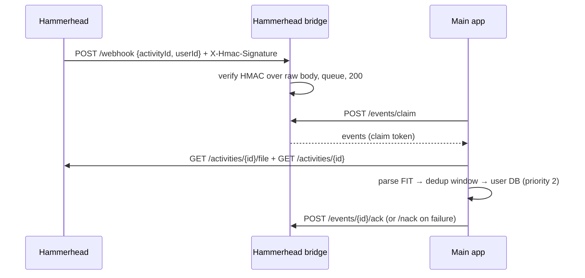

# Hammerhead (Karoo)

Hammerhead is the **first two-way integration** (openkoutsi#69). For each kind of data exactly
one side is the source of truth:

| Data | Source of truth | Direction |
|---|---|---|
| Activities | Karoo | pulled — history sync + webhooks |
| Training metrics (FTP, weight, HR, zones) | openkoutsi | pushed — `POST /metrics` |
| Routes | openkoutsi (courses) | pushed — `POST`/`PUT /routes/file` |

The split is forced by the API rather than chosen: there is **no `GET /metrics`** and **no route
download** (`GET /routes` returns `{id, name, createdAt, distance, gain}`, no geometry). So zone
*sync* does not apply here, and route sync is push-only.

## Connecting

OAuth 2.0 authorization code at `https://api.hammerhead.io/v1/auth/oauth/{authorize,token,deauthorize}`,
driven by the generic `/integrations/hammerhead/connect` and `/callback` routes. The token response
carries `user_id`, so — unlike Wahoo — `provider_athlete_id` needs no profile call.

Scopes requested: `activity:read` (activities **and** webhooks), `route:read`, `route:write`,
`workout:write`, `metrics:write`.

!!! note "Partial grants"
    A user may grant a subset, and the token response carries no `scope` field, so nothing is
    gated at connect time. Each capability degrades on its own 403 instead: the client raises
    `ScopeNotGranted`, and the push endpoints answer `403 insufficient_scope`.

A refusal on the consent screen redirects to the callback with `?error=access_denied&state=…`
and no `code`; the callback sends the browser back with `?hammerhead=denied`.

!!! warning "Disconnect is destructive on Hammerhead's side"
    `/oauth/deauthorize` removes the account link **and deletes every route and workout this
    client created** for the user. The web app warns before disconnecting.

## Activity import

`HammerheadClient` (`services/providers/hammerhead.py`) plugs into the generic
[provider sync pipeline](../architecture/backend.md), with one twist.

The list endpoint (`GET /activities?page&perPage&startDate`) returns only `id`, `name`,
`createdAt`, `duration`, `distance` — no start time, no sport, no power/HR/cadence. `createdAt` is
a record-creation timestamp, and using it as the start time would break the ±5-minute duplicate
match against the same ride from Strava or Wahoo. So:

1. `list_activities()` returns **sparse** records (`createdAt` as a provisional start).
2. The pipeline skips anything already imported on `(provider, external_id)` alone — no further
   calls.
3. For an activity it will import or repair, the pipeline calls the new
   `BaseProviderClient.complete_activity()` hook **before the duplicate-window query**.
   Hammerhead's implementation downloads the FIT (`GET /activities/{id}/file`) and the detail
   (`GET /activities/{id}`, for `activityType` and the name), and returns a record dated by the
   FIT. The FIT is cached on the client, so the import that follows does not fetch it again.

Pagination uses `perPage=100` and stops on `currentPage >= totalPages` — no empty-page probe.
Requests go through `provider_client()` (usage attribution) and 429/5xx map through
`providers/throttling.py` like every provider.

- **Sport mapping:** `RIDE` → `Ride`, `EBIKE` → `EBikeRide`, `MOUNTAIN_BIKE` → `MountainBikeRide`,
  `GRAVEL` → `GravelRide`, `EMOUNTAIN_BIKE` → `EMountainBikeRide`, `VELOMOBILE` → `Velomobile`.
- **Source priority:** `hammerhead` with a FIT = **2**, beside Wahoo-with-FIT and above Strava (3)
  — the Karoo FIT is the device recording.

## Webhooks → bridge

`hammerhead_bridge/` follows the bridge pattern with two differences from Wahoo's:

- **HMAC, always on.** `X-Hmac-Signature` is HMAC-SHA256 of the raw body keyed with
  `HAMMERHEAD_WEBHOOK_SECRET`, verified against the bytes as received and compared in constant
  time. With no secret configured every delivery is refused.
- **Hammerhead does not redeliver** — a non-200 is ignored. The bridge only verifies, persists
  and returns 200; the queue (issue #50 claim/ack/nack, `max_queue_events`, 7-day purge) is the
  only retry an event gets.

The payload is only `{activityId, userId}`. `process_hammerhead_webhook` resolves the user via
`provider_connections.provider_athlete_id`, refreshes the token, and imports through
`complete_activity()` — two authenticated calls. It is idempotent on the activity id, which
covers Hammerhead's documented manual retry as well as bridge redelivery.

## Pushing metrics

`POST /integrations/hammerhead/push-metrics` sends `Athlete` fields one-to-one:

| `Athlete` | Hammerhead `Metrics` |
|---|---|
| `weight_kg` | `weightInKilograms` |
| `ftp` | `powerFtp` |
| `max_hr` | `maxHr` |
| `resting_hr` | `restingHr` |
| `hr_zones` | `heartRateZones[]` |
| `power_zones` | `powerZones[]` |

Zones are renamed `{low, high, name}` → `{min, max, name}`; the array has no length limit, so the
full 7 power / 5 HR zones go as they are. `POST /metrics` is a partial update, so `None` fields are
**omitted**, leaving them editable on the Karoo. Setting
`app_settings.hammerhead_auto_push_metrics` makes `PATCH /athlete` push in the background whenever
one of those fields changes.

## Pushing routes

`POST /courses/{course_id}/push/hammerhead` uploads the course's **original GPX** — already
stored encrypted at rest — via `POST /routes/file`. The returned id is kept in the per-user
`hammerhead_route_uploads` table (`course_id` ↔ `hammerhead_route_id`), so a re-push is
`PUT /routes/{id}/file` (falling back to a new upload if the route was deleted on the Karoo), and
deleting the course issues `DELETE /routes/{id}`. `Course` itself is untouched. The route sits
behind the course-recon switch with every other course route.

## Configuration

| Variable | Where | Purpose |
|---|---|---|
| `HAMMERHEAD_CLIENT_ID`, `HAMMERHEAD_CLIENT_SECRET` | Main app | OAuth app credentials |
| `HAMMERHEAD_BRIDGE_URL` | Main app | Base URL of the Hammerhead bridge to poll |
| `HAMMERHEAD_BRIDGE_SECRET` | Main app **and** bridge | Shared secret for polling auth (≥ 32 chars) |
| `HAMMERHEAD_WEBHOOK_SECRET` | Bridge | HMAC key for `X-Hmac-Signature` |

## Open questions

Not answered by the published spec, to confirm against the live API: rate limits (each new
activity costs a detail call plus a FIT download), units of the summary's `duration`/`distance`
(unused — the FIT is authoritative), the encoding of `X-Hmac-Signature` (the bridge accepts hex or
base64), whether granted scopes are ever returned, and whether the API licence requires visual
attribution.
